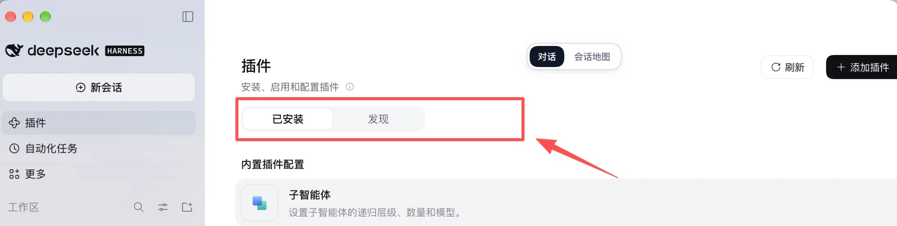
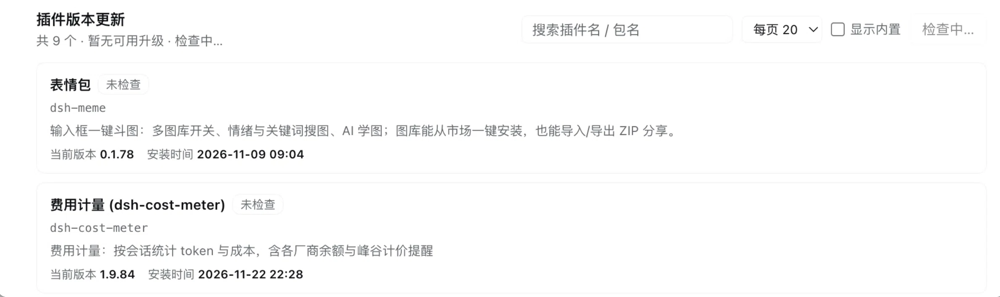

# dsh-plugin-update-hub

**An update hub for the plugins you already installed in DeepSeek Harness.**

[](https://www.npmjs.com/package/dsh-plugin-update-hub)
[](LICENSE)
[](#compatibility)

[简体中文](README.zh.md) · [English](README.md)

Plugins installed from the market never told you when a newer version shipped — the stock plugin page has no version column at all, so the only upgrade path was uninstall and reinstall. This plugin adds a **Plugin updates** tab next to *Installed* and *Discover*: every installed plugin with its current version, install date, how many releases behind it is, and a version picker.

Also indexed by [dshfind](https://dshfind.com/en/plugins/darianzes/dsh-plugin-update-hub), a community directory that syncs GitHub `dsh-plugin` repositories daily.

## Install

### CLI (recommended)

```sh
# once per machine, if you don't have the CLI yet
npm i -g @deepseek-ai/dsh

# install the plugin into the profile you launch
dsh plugin --profile web add dsh-plugin-update-hub
```

- Replace `web` with the profile you actually run (`tui`, `headless`, ...); `dsh plugin --profile <name> <args>` forwards the remaining arguments to pnpm inside that profile's directory.
- Requires Node ≥ 22.13 and a `pnpm` on `PATH` (the CLI reports `dsh: pnpm was not found` when it is missing).
- The Desktop app's `desktop` profile is owned by the application: the CLI refuses to manage it (`profile "desktop" is managed exclusively by the Electron application`). Desktop users install from **Plugins → Discover**, paste `dsh-plugin-update-hub` in **Add plugin**, or ask the agent to install it.
- Verify it loaded:

  ```sh
  dsh --profile web --dump-config | grep -A2 'dsh-plugin-update-hub'
  ```

### From a checkout

```sh
git clone https://github.com/darianzes/dsh-plugin-update-hub
dsh plugin --profile web add ./dsh-plugin-update-hub
```

## Update

```sh
# let pnpm move it to the newest release in range
dsh plugin --profile web update dsh-plugin-update-hub

# or pin the newest release explicitly
dsh plugin --profile web add dsh-plugin-update-hub@latest
```

Every one of these is also handled by the tab itself once installed — see below.

## Update from the tab





- Every row shows: display name, package name, description, current version, install time, status (`up to date` / `N versions behind` / `built-in` / `git install` / `disabled`) and the newest version.
- Outdated rows get a version dropdown (releases newer than the installed one, newest first) and an **Update** button.
- Fuzzy search over name / package / description, several keywords combined.
- Page size 10 / 20 / 50, default 20, remembered in `localStorage`.
- **Show built-in** toggle, off by default (official bundles ship with DSH and cannot be upgraded alone).
- **Check updates** runs a concurrent check over every checkable row in the current result set — the rest show `等待检查…` (waiting) while queued; one automatic check runs when you open the tab, throttled to once every 6 hours.
- Concurrency starts at 2 / 3 / 4 depending on cores and memory, then adapts to registry latency: slows down when responses are slow, grows back up to the ceiling when they are fast.
- Batch upgrades: **批量更新 (N)** queues every upgradable row in the current filter at the chosen version; a single row's **Update** just enqueues one task.
- The queue is serial (installs share the profile's store, they cannot run in parallel), collapsible and collapsed by default — collapsed it shows one summary line (`更新队列 · 1 个更新中 · 2 个排队中`) plus the live percentage and a thin progress bar; expanded it shows each task's `waiting / checking / removing / installing / done / failed` and elapsed time.
- The queue lives in memory only: if DSH quits or is interrupted, queued tasks are simply gone on the next start. **Clear queue** / **Clear finished** are available too.
- Progress follows the Host's own `plugin-manager/update-state` steps (check / remove / install / restore); failures show the reason.

## How it works

- `index.js` — Host half, `export const inject = ['webServer']`. Registers the exact route `/dsh-plugin-update-hub-api`, returning each requested package's install time (the mtime of the pnpm symlink in the profile's `node_modules`) plus the `description` / `version` from its `package.json`. The profile directory is resolved from `DSH_PROFILE_DIR`, `DSH_HOME/profiles/$DSH_PROFILE`, the host process argv, the module path, and finally `~/.dsh/profiles/*`, validated by `node_modules` + `cordis.patch.yml` so the read-only app install directory is never picked. The route delegates admission to the runtime's own `connection.requestRejection(req)` and rejects when that fence is missing or throws, so it inherits the app's browser authentication instead of guessing from Host or Origin. No `@deepseek-ai` dependency.
- `client.js` — Client half. Registers `plugins.tab` as `{ id: 'updates', order: 10, label: '插件更新' }`; data comes from `ctx.get('remote.pluginManager')` (`listBundles` / `listVersions` / `updateBundle` / `cancelInstall`), progress from `ctx.get('remote').$on('plugin-manager/update-state' | 'plugin-manager/changed')`. Remote calls resolve to an `{ ok, value | error }` envelope, unwrapped in one place.
- Only `react` and `--dsw-alias-*` theme tokens are used — no Harness client packages, no JSX.

## Compatibility

- DSH `>=0.2.2-0 <0.3.0`, Node `>=22.13.0`.
- Only bundles installed from an npm registry can be upgraded; git and link installs are labelled and left alone, official bundles follow the DSH release.
- Upgrades are performed by the Host plugin manager: it checks that the target version exists, declares a bundle, and accepts the running DSH version, and rolls back to the previous version if anything fails. Some upgrades need a DSH restart; the tab says so.

## Development

```sh
npm test    # smoke test: runs client.js in a fake browser with a mocked remote
```

## License

MIT
