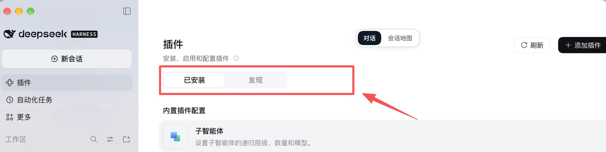
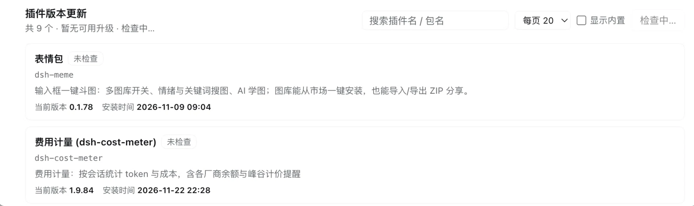

# dsh-plugin-update-hub

**给 DeepSeek Harness 已装插件补上「版本落后提示」与「按版本升级」。**

[](https://www.npmjs.com/package/dsh-plugin-update-hub)
[](LICENSE)
[](#兼容性)

[简体中文](README.zh.md) · [English](README.md)

从插件市场装的插件落后了,原来的插件页不会提示,也没有版本列,只能卸载重装。这个插件在侧边栏的**插件**页加一个「插件更新」tab:一次列出所有已装插件的当前版本、安装时间、落后几个版本,并支持选版本升级。

## 安装

### 命令行(推荐)

```sh
# 机器上还没装 CLI 时先装一次
npm i -g @deepseek-ai/dsh

# 装进你平时启动的那个 profile
dsh plugin --profile web add dsh-plugin-update-hub
```

- 把 `web` 换成你实际用的 profile(`tui`、`headless` 等);`dsh plugin --profile <name> <args>` 会把后面的参数原样转给该 profile 目录里的 pnpm。
- 需要 Node ≥ 22.13,并且 `PATH` 上有 `pnpm`(缺了会报 `dsh: pnpm was not found`)。
- 桌面端用的是应用独占管理的 `desktop` profile,命令行改它会被拒绝(`profile "desktop" is managed exclusively by the Electron application`)。桌面用户走 **插件 → 发现**,或在「添加插件」里填 `dsh-plugin-update-hub`,也可以直接让 agent 安装。
- 装完确认已加载:

  ```sh
  dsh --profile web --dump-config | grep -A2 'dsh-plugin-update-hub'
  ```

### 从源码装

```sh
git clone https://github.com/darianzes/dsh-plugin-update-hub
dsh plugin --profile web add ./dsh-plugin-update-hub
```

## 命令行更新

```sh
# 让 pnpm 升到范围内的最新版本
dsh plugin --profile web update dsh-plugin-update-hub

# 或直接装最新版
dsh plugin --profile web add dsh-plugin-update-hub@latest
```

装好之后,这些也都能在这个 tab 里点着完成 —— 见下。

## 在 tab 里更新





- 每行显示:插件名、包名、简介、当前版本、安装时间、状态(已是最新 / 落后 N 个版本 / 内置 / Git 安装 / 已禁用)和最新版本。
- 落后时出现版本下拉(比当前新的已发布版本,最新在前)+「更新」按钮。
- 插件名 / 包名 / 简介模糊搜索,多个关键词同时匹配。
- 分页:每页 10 / 20 / 50,默认 20,选择记在 `localStorage`。
- 「显示内置」开关,默认关闭(内置 bundle 随 DSH 发行,不能单独升级)。
- 「检查更新」一次并发检查当前结果集里所有可检查的插件,排队的显示「等待检查…」;打开 tab 时自动检查一次,6 小时内不重复。
- 并发数按核心数与内存起算 2 / 3 / 4,再随 registry 响应时间自适应:慢了就减,快了往上限加回来。
- 支持批量:「批量更新 (N)」把当前筛选结果里所有可升级插件按所选版本排进队列;单个「更新」也是入队一个任务。
- 队列串行(安装共用 profile 的 store,不能并行),**默认折叠**:折叠时只显示一行汇总(`更新队列 · 1 个更新中 · 2 个排队中`)、当前百分比和一条细进度条;展开后看每个任务的 `等待更新 / 正在校验 / 移除 / 安装 / 已完成 / 失败` 与已用时间。
- 队列只在内存里:DSH 意外关闭或中断后,排队任务直接消失,不会在下次启动时恢复。也可以手动「清空队列」/「清空已完成」。
- 进度按 Host 广播的 `plugin-manager/update-state` 步进(校验 / 移除 / 安装 / 回滚),失败会显示原因。

## 实现

- `index.js`(Host 半边,`export const inject = ['webServer']`):注册 exact 路由 `/dsh-plugin-update-hub-api`,按包名返回 profile `node_modules` 的安装时间(pnpm symlink 自身的 mtime)以及包 `package.json` 的 `description` / `version`。profile 目录依次从 `DSH_PROFILE_DIR`、`DSH_HOME/profiles/$DSH_PROFILE`、宿主进程 argv、模块路径上溯、`~/.dsh/profiles/*` 里找,用 `node_modules` + `cordis.patch.yml` 判定,排除只读的 app 安装目录。路由的准入交给运行时自己的 `connection.requestRejection(req)`,该栅栏缺失或抛错时一律拒绝(fail closed),不靠 Host / Origin 猜。除运行时注入的 `webServer` / `connection` 外不依赖任何 `@deepseek-ai` 包。
- `client.js`(Client 半边):把 `plugins.tab` 注册成 `{ id: 'updates', order: 10, label: '插件更新' }`;数据走 `ctx.get('remote.pluginManager')` 的 `listBundles` / `listVersions` / `updateBundle` / `cancelInstall`,进度走 `ctx.get('remote').$on('plugin-manager/update-state' | 'plugin-manager/changed')`。Remote 调用返回 `{ ok, value | error }` 信封,统一拆。
- 只用 `react` 和 `--dsw-alias-*` 主题 token,不引入 Harness 客户端包,不写 JSX。

## 兼容性

- DSH `>=0.2.2-0 <0.3.0`,Node `>=22.13.0`。
- 只有从 npm registry 安装的 bundle 能升级;git 安装和 link 安装会被标注且不做版本升级,内置 bundle 跟随 DSH 发行。
- 升级由 Host 的 plugin manager 执行:先校验目标版本存在、声明了 bundle、接受当前 DSH 版本,失败会自动回滚重装旧版。有的更新需要重启 DSH 才生效,界面会提示。

## 开发

```sh
npm test    # 冒烟测试:在假浏览器里跑 client.js,mock remote
```

## License

MIT
